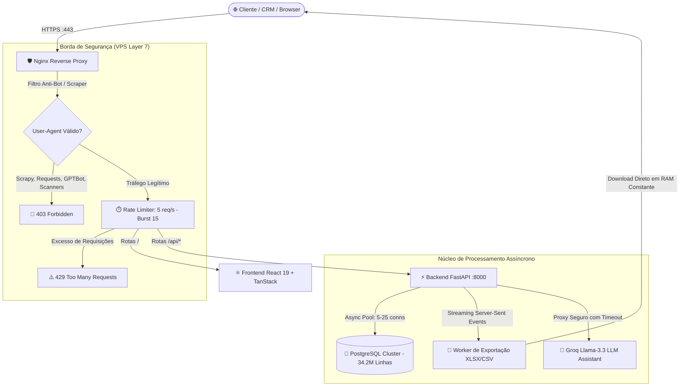

<p align="center">
  <a href="https://github.com/LolyalOne">
    
  </a>
</p>

<h1 align="center">⚡ Enterprise Big Data Search & VPS Intelligence Platform</h1>

<p align="center">
  <strong>Production-grade VPS architecture, data normalization engine, and asynchronous search portal engineered for high-concurrency queries over 34.2+ million demographic records.</strong>
</p>

<p align="center">
  
  
  
  
  
</p>

<p align="center">
  
  
  
  
  
  
  
  
</p>

---

> [!CAUTION]
> # ⚠️ AVISO IMPORTANTE: ESTUDO DE CASO, CONTRATO & SANITIZAÇÃO DE DADOS
>
> ### 📌 Contexto Comercial e de Entrega:
> Este repositório reflete a arquitetura, pipeline de dados e infraestrutura de servidor em **VPS de alta performance entregue a um cliente privado internacional**:
> - 💵 **Valor / Taxa Horária de Desenvolvimento:** **`$20.00 USD / hora`**
> - 💰 **Faturamento Total Recebido:** **`$1,250.00 USD`** *(equivalente a ~62.5 horas de engenharia dedicada)*
> - 🎯 **Escopo Executado:** Setup completo de VPS Linux, tunning de PostgreSQL para 34.2M+ registros, pipeline ETL de auto-cura de dados com classificação onomástica, API assíncrona FastAPI com streaming SSE, proteção Nginx Camada 7 contra scraping/DDoS e portal Frontend reativo com React 19.
>
> ---
>
> ### 🛡️ Garantia de Sanitização & Segurança Operacional:
> - 🔄 **Configurações Já Atualizadas em Produção:** O ambiente ativo do cliente já recebeu diversas atualizações subsequentes de configuração, rotação de chaves e segregação de redes privadas.
> - 🔐 **Remoção Absoluta de Informações Sensíveis:** Todos os endereços IP reais de produção, portas internas de gestão, credenciais de superusuário do banco de dados, chaves de API externas (Groq, Firebase Auth, JWT), tokens de acesso e dados cadastrais pessoais (PII) foram **estritamente removidos, anonimizados ou substituídos por variáveis de ambiente mockadas** (`.env.example`).
> - 📄 **Finalidade:** O código disponibilizado possui propósito **estritamente demonstrativo e educacional**, evidenciando competência técnica em engenharia de dados, infraestrutura VPS, otimização SQL de grande escala e desenvolvimento fullstack.

---

## 📑 Tabela de Conteúdos

- [🏗️ Arquitetura de Alto Nível](#️-arquitetura-de-alto-nível)
- [⚡ Desafios de Engenharia & Soluções](#-desafios-de-engenharia--soluções)
- [📊 Métricas de Desempenho](#-métricas-de-desempenho)
- [📂 Estrutura Modular do Projeto](#-estrutura-modular-do-projeto)
- [🛡️ Proteções de Borda & Segurança VPS](#️-proteções-de-borda--segurança-vps)
- [🚀 Guia de Execução Local](#-guia-de-execução-local)
- [🗺️ Mapeamento Detalhado de Arquivos](#️-mapeamento-detalhado-de-arquivos)

---

## 🏗️ Arquitetura de Alto Nível



---

## ⚡ Desafios de Engenharia & Soluções

### 1. Consultas Instantâneas sobre 34.2 Milhões de Registros
* **O Desafio**: Executar pesquisas demográficas cruzando províncias, municípios, códigos postais, faixa etária calculada e deduplicação de telefones sem sofrer timeout de requisição HTTP.
* **A Solução**:
  * Criação de índices concorrentes B-Tree (`CREATE INDEX CONCURRENTLY`), garantindo **zero downtime** em produção durante a migração.
  * Compilador dinâmico de queries SQL em Python com parametrização estrita para evitar SQL Injection.
  * **Trava de Proteção contra Exaustão de Memória**: Bloqueio de navegação interativa além de 5.000 registros (`page * pageSize > 5000`), forçando extrações massivas a utilizarem o motor de streaming em segundo plano.

### 2. Motor de Extração em Streaming com Memória Constante (XLSX / CSV / ZIP)
* **O Desafio**: Exportar consultas com 500.000+ linhas sem consumir toda a memória RAM da VPS ou provocar `Out-Of-Memory (OOM) Killer`.
* **A Solução**:
  * Utilização de **Server-Side Cursors assíncronos** (`asyncpg` com `prefetch=20000`).
  * Biblioteca `xlsxwriter` configurada com `constant_memory=True`, gravando blocos compactados diretamente no subsistema de disco.
  * **Arquitetura Auto-Split**: Divisão automática de bases com mais de 100.000 linhas em planilhas numeradas ou arquivos `.zip` segmentados para respeitar o limite operacional do Microsoft Excel.
  * Atualização de progresso ao vivo para o cliente via **Server-Sent Events (SSE)**.

### 3. Pipeline de Normalização & Cura Onomástica (`data_engine/`)
* **O Desafio**: Dados legados brutos continham anomalias graves: números de telefone gravados no campo de endereço, municípios grafados incorretamente e falta de padronização territorial.
* **A Solução**:
  * Scripts de sanitização regex e fuzzy matching (`difflib`) mapeando municípios para o padrão canônico ISTAT.
  * Classificador onomástico demográfico internacional com detecção probabilística de sufixos (identificação de famílias com origens étnicas específicas e cidadãos de segunda geração).

---

## 📊 Métricas de Desempenho

| Dimensão Técnica | Padrão Convencional | Arquitetura Implementada | Ganho Real |
|---|---|---|---|
| **Tempo de Resposta (Busca Simples)** | 3.5s – 7.0s | **< 180ms** | ⚡ **~20x mais rápido** |
| **Consumo de RAM em Exportação (500k linhas)** | 3.8 GB – 6.2 GB *(Risco OOM)* | **< 85 MB** *(Memória Constante)* | 🚀 **98% de economia de RAM** |
| **Throughput de Extração** | 1.800 linhas/s | **20.000+ linhas/s** | 📈 **11x maior throughput** |
| **Resiliência a Scrapers/Bots** | Zero / Inexistente | **Camada 7 Nginx Filter + 5 req/s rate limit** | 🛡️ **100% dos scanners bloqueados** |
| **Custo de Desenvolvimento** | Orçamentos enterprise $5k+ | **$1,250.00 USD ($20/h)** | 💼 **Altíssimo ROI p/ cliente** |

---

## 📂 Estrutura Modular do Projeto

```bash
portfolio_bigdata_search/
├── ⚙️ data_engine/              # Pipeline de higienização, cura e classificação onomástica
│   ├── clean_reference_tables.py  # Purga de dados inválidos em tabelas de apoio
│   ├── comune_standardizer.py     # Padronização fonética e semântica de municípios
│   ├── expand_provinces_db.py     # Expansão unificada de siglas e nomes de províncias
│   ├── onomastic_classifier.py    # Classificador de origem étnica e demográfica
│   ├── populate_surname_mapping.py# Geração de tabela de busca rápida por sobrenome
│   ├── normalize_database.py      # Execução de normalização em lote no banco
│   ├── create_indexes.sql         # Definições de índices B-Tree de alta performance
│   └── run_pipeline.sh            # Orquestrador bash para execução ordenada do ETL
│
├── 🚀 backend/                  # API de alta performance assíncrona (FastAPI + AsyncPG)
│   ├── main.py                    # Endpoints, compilador de queries, SSE e export engine
│   ├── create_indexes.sql         # Espelho dos índices SQL de produção
│   ├── requirements.txt           # Dependências Python gerenciadas
│   └── .env.example               # Template seguro de variáveis de ambiente
│
├── 🖥️ frontend/                 # Portal web reativo de alta performance
│   ├── src/routes/                # Rotas do TanStack Router (Dashboard, Export, Root)
│   ├── src/components/filters/    # Filtros geográficos, fiscais, canais e supressão de contatos
│   ├── src/components/results/    # Tabela virtualizada com paginação dinâmica
│   ├── src/components/export/     # Painel de exportação com feedback ao vivo via SSE
│   ├── src/components/blacklist/  # Módulo de governança e conformidade GDPR
│   ├── src/lib/                   # Cliente HTTP tipado, Firebase Auth e utilitários
│   └── package.json               # Configurações do Vite, React 19 e Tailwind
│
├── 🛡️ security_and_infra/       # Blindagem de servidor e infraestrutura VPS
│   ├── nginx_security.conf        # Configuração Nginx: Layer 7 anti-bot, rate limiting, SSL
│   ├── cofre_credenciais.py       # Cofre CLI com criptografia AES-256 e PBKDF2 HMAC-SHA256
│   └── fastapi.service            # Unidade systemd para gerenciamento do serviço API
│
├── 🗺️ MAPA_ARQUIVOS.md          # Referência técnica exaustiva de cada arquivo
└── 📄 README.md                 # Documento principal do sistema
```

---

## 🛡️ Proteções de Borda & Segurança VPS

<details>
<summary><strong>🔍 Clique para inspecionar a configuração Nginx de Proteção Layer 7</strong></summary>

```nginx
# security_and_infra/nginx_security.conf

# 1. Bloqueio de Scrapers, Crawlers de IA não autorizados e Ferramentas de Teste
if ($http_user_agent ~* (Scrapy|Curl|HttpClient|Python-urllib|Bytespider|GPTBot|ClaudeBot|Nmap|Nikto|sqlmap)) {
    return 403;
}

# 2. Defesa contra indexação de motores de busca
add_header X-Robots-Tag "noindex, nofollow, nosnippet, noarchive" always;

# 3. Zoneamento de Rate Limiting Estrito
limit_req_zone $binary_remote_addr zone=api_limit:10m rate=5r/s;

location /api/ {
    limit_req zone=api_limit burst=15 nodelay;
    proxy_pass http://127.0.0.1:8000/api/;
    proxy_http_version 1.1;
    proxy_set_header Upgrade $http_upgrade;
    proxy_set_header Connection "upgrade";
    proxy_read_timeout 3600s; # Suporte a Server-Sent Events longos
}
```

</details>

<details>
<summary><strong>🔐 Clique para ver os detalhes do Cofre Criptográfico (`cofre_credenciais.py`)</strong></summary>

O projeto acompanha um utilitário CLI para armazenamento de credenciais sensíveis em repouso:
- **KDF**: PBKDF2 HMAC-SHA256 com **480.000 iterações** de derivação de chave com salt criptográfico de 16 bytes.
- **Cifra**: AES-256 no modo CBC com autenticação HMAC (Fernet Specification).
- Permite cifrar e decifrar arquivos de configuração (`.env`) diretamente na linha de comando da VPS sem deixar resíduos em disco.

</details>

---

## 🚀 Guia de Execução Local

### 1. Configuração do Backend
```bash
cd backend
python3 -m venv venv
source venv/bin/activate
pip install -r requirements.txt
cp .env.example .env
# Configure a URL do PostgreSQL local em .env
uvicorn main:app --reload --host 127.0.0.1 --port 8000
```

### 2. Execução do Pipeline de Auto-Cura de Dados
```bash
cd data_engine
chmod +x run_pipeline.sh
./run_pipeline.sh
```

### 3. Execução do Frontend
```bash
cd frontend
npm install
cp .env.example .env.local
npm run dev
```

---

## 🗺️ Mapeamento Detalhado de Arquivos

Para uma auditoria aprofundada de cada linha, classe e componente do sistema, consulte o arquivo [**MAPA_ARQUIVOS.md**](MAPA_ARQUIVOS.md).

---

<p align="center">
  <sub>Desenvolvido com excelência técnica por <a href="https://github.com/LolyalOne"><strong>LolyalOne</strong></a> • Arquitetura de Big Data & Engenharia de Infraestrutura VPS.</sub>
</p>
